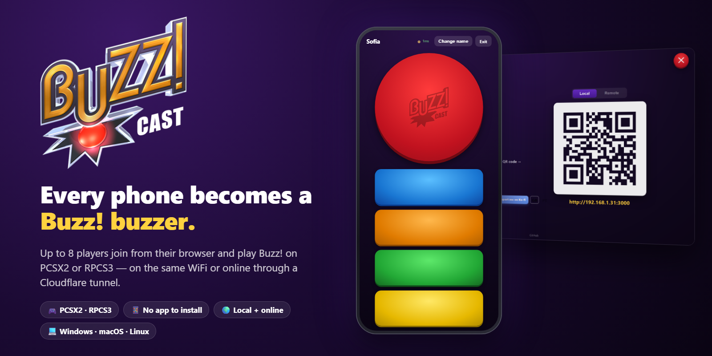
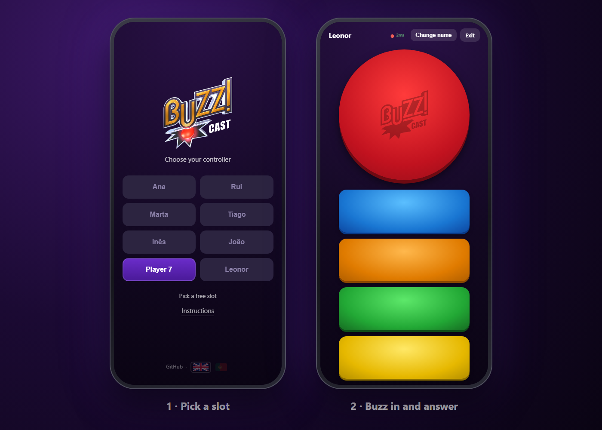
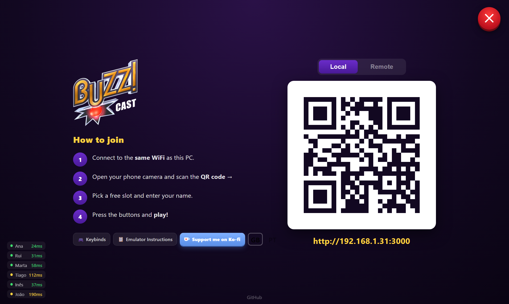
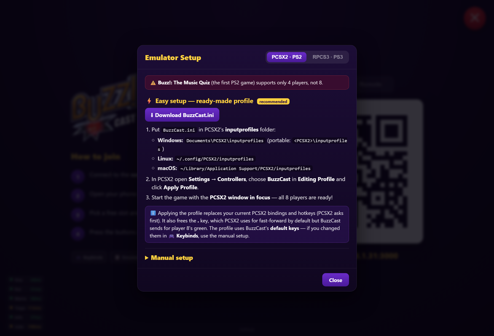
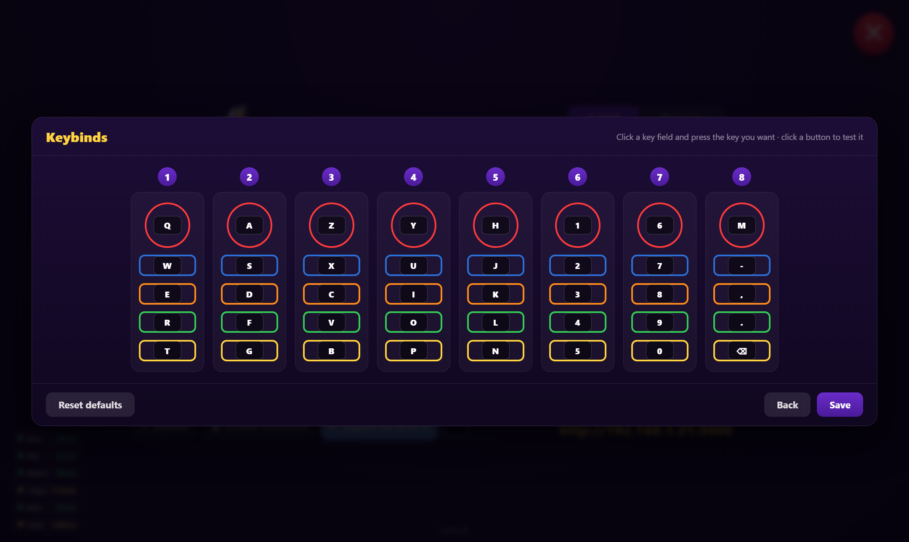

<div align="center">



**Turn any phone into a Buzz! buzzer for PCSX2 and RPCS3.**<br>
Up to 8 players join from their browser — on the same WiFi or online through a Cloudflare tunnel. No app, no pairing.

<a href="https://github.com/bacoinz/buzzcast/releases/latest"></a> <a href="https://github.com/bacoinz/buzzcast/releases"></a> <a href="LICENSE"></a>    <a href="https://ko-fi.com/bacoinz"></a>

[Download](https://github.com/bacoinz/buzzcast/releases/latest) · [Getting started](#getting-started) · [Emulator setup](#emulator-setup) · [Troubleshooting](#troubleshooting) · [Changelog](CHANGELOG.md) · [☕ Ko-fi](https://ko-fi.com/bacoinz)

</div>

## Why BuzzCast

The Buzz! games are some of the best party games ever made — but they need the plastic buzzers, which are hard to find, and only work for people in the same room.

BuzzCast replaces them with the phones everyone already has. It runs on the PC with the emulator, serves a small web app, and turns each tap into a **keyboard key** — the emulator can't tell it apart from a real keyboard. Players scan a QR code, pick a slot and play; friends far away join through a Cloudflare tunnel while you stream the game on Discord or Parsec.

**Available for Windows, macOS and Linux** — one standalone download per OS, nothing else to install.

## Screenshots

<div align="center">



<sub>On the phone: pick a free slot, then buzz in and answer.</sub>



<sub>On the PC: the host page — QR code to join, local or online, live latency for every player, Keybinds, emulator instructions.</sub>

<table>
<tr>
<td></td>
<td></td>
</tr>
<tr>
<td align="center"><sub>Emulator setup — ready-made PCSX2 / RPCS3 profiles</sub></td>
<td align="center"><sub>Keybinds — change any key and test each button live</sub></td>
</tr>
</table>

</div>

---

## What's new in v1.4

- 🎮 **RPCS3 (PS3) support** — setup steps for PCSX2 and RPCS3 in the host's **Emulator Instructions** popup.
- 📦 **Ready-made emulator profiles** — download [`BuzzCast.ini`](https://github.com/bacoinz/buzzcast/releases/latest/download/BuzzCast.ini) (PCSX2) or [`BuzzCast.yml`](https://github.com/bacoinz/buzzcast/releases/latest/download/BuzzCast.yml) (RPCS3), drop it in the emulator's profiles folder, load it and play ([how](#emulator-setup)).
- ✅ **Buttons now register in-game** — presses that reached the emulator's mapping screen but were ignored during the game are fixed (keys are now held ~80 ms instead of <1 ms).
- 💾 **Keybinds are saved** between runs in the downloadable app, and the **Install / Uninstall cloudflared** buttons work there too ([where files are kept](#where-buzzcast-keeps-its-files)).
- 🔒 **Host-only controls** — remote players can no longer reach the Host page, change keys or shut BuzzCast down through the tunnel link.
- 📱 Better **screen wake lock** on iPhone, plus smaller fixes.

Full history in the [CHANGELOG](CHANGELOG.md).

---

## How it works

```
Phone (browser) ──WebSocket──► BuzzCast on PC ──keyboard emulation──► PCSX2 / RPCS3
```

- **Up to 8 players** on their own phones (7 on RPCS3) — no apps, no pairing.
- **Local or remote** play (LAN QR code or Cloudflare Tunnel for online).
- **Works with PCSX2 and RPCS3** — setup steps for both are in the host's **Emulator Instructions** popup.
- **Low-latency keyboard injection**, layout-aware, native per OS (Windows `keybd_event`, Linux Wayland `uinput` / X11 `XTest`, macOS CoreGraphics).
- **Customisable keys** — change any pad's key from the host's **Keybinds** menu (with live test feedback); defaults below.
- **Live latency indicator** per player, on both the controller and the host screen.
- **Auto-reconnect** with exponential backoff if WiFi drops.
- **Screen stays awake** — the controller holds a wake lock so phones don't dim mid-game (Android Chrome; iOS Safari needs HTTPS — see [Troubleshooting](#troubleshooting)).
- **Update notifications** — the host checks GitHub and shows a banner when a new version is out.

---

## Requirements

- A **Windows, macOS or Linux PC** running **PCSX2** (PS2) or **RPCS3** (PS3) with a Buzz! game.
- Phones on the **same WiFi** as the PC (for local play).
- No installs needed on phones — just a browser.
- Linux: an **X11 or Wayland** session. Wayland injects through a virtual keyboard (`/dev/uinput`; most desktops grant the logged-in user access), X11 needs `libxtst6`. macOS: grant **Accessibility** permission when asked.

> **No Node.js or Bun required.** The BuzzCast download is a standalone executable that includes its own runtime. Just run it and play.

---

## Getting started

### Option A — Download for your OS *(easiest)*

Grab the latest build from [Releases](https://github.com/bacoinz/buzzcast/releases) and run it — a browser tab opens automatically:

| OS | Download |
|---|---|
| **Windows** | `BuzzCast v<x.y>.exe` — double-click |
| **Linux** | `BuzzCast-v<x.y>-x86_64.AppImage` (`chmod +x`, then run) or the raw `BuzzCast-v<x.y>-linux-x86_64` binary |
| **macOS** | `BuzzCast-v<x.y>-macos.zip` — unzip, then right-click → **Open** (unsigned app) |

### Option B — Run from source

With [Bun](https://bun.sh) (recommended):
```sh
bun install
bun run src/bun-server.js     # or: bun run dev
```

Legacy Node.js fallback:
```sh
npm install
node legacy/server.js
```

### Build it yourself

Requires [Bun](https://bun.sh) installed. Builds for your current OS by default:

```sh
bun install
bun run build      # → scripts/build.js
```

Cross-compile a specific target from any OS:

```sh
BUILD_TARGET=windows bun run build
BUILD_TARGET=linux   bun run build
BUILD_TARGET=macos   bun run build
```

Outputs a standalone binary (~95 MB, version from `package.json`). All three are also built automatically by CI on each tagged release.

---

## Playing locally (same WiFi)

1. Run BuzzCast — the **Host** page opens automatically.
2. Players scan the **Local QR code** with their phone camera, or type the URL shown.
3. Each player picks a free slot and enters their name.
4. The controller screen appears — ready to play!

---

## Playing remotely (online / streaming)

BuzzCast supports **online multiplayer** via [Cloudflare Tunnel](https://developers.cloudflare.com/cloudflare-one/connections/connect-networks/do-more-with-tunnels/trycloudflare/) — no account or port forwarding required.

This works great with any screen-sharing or streaming app:

| Scenario | How |
|---|---|
| **Discord / Parsec / Moonlight stream** | Host shares their screen. Remote players use their own phone to open the BuzzCast Remote URL. |
| **Playing across the internet** | Same as above — the Cloudflare tunnel gives remote players a public HTTPS link. |

### Setup

1. In the **Host** page, click the **Remote** tab.
2. If Cloudflare isn't detected, click **Install** — BuzzCast downloads it silently (~35 MB, no admin rights needed). You can uninstall it later from the same tab. (Already have `cloudflared`? Put it on your `PATH` or next to the BuzzCast executable and it's picked up automatically.)
3. Once the tunnel starts, a QR code and a `https://…trycloudflare.com` URL appear.
4. Remote players open that URL on their phones — they join the **same lobby** as local players.

> The host streams their screen via Discord/Parsec/etc. while remote players control Buzz! from their own phones using the tunnel URL.

> 🔒 The **Host** page and its controls (Keybinds, Install/Uninstall, Shut down) only work from the PC running BuzzCast. Players — local or through the tunnel — can only reach the lobby and controller.

### Where BuzzCast keeps its files

Your saved **Keybinds** (`keymap.json`) and the `cloudflared` downloaded by the Install button live in a per-user folder:

| OS | Folder |
|---|---|
| Windows | `%LOCALAPPDATA%\BuzzCast` |
| macOS | `~/Library/Application Support/BuzzCast` |
| Linux | `~/.local/share/buzzcast` (or `$XDG_DATA_HOME/buzzcast`) |

---

## Key map

**Default** keys — 8 players × 5 buttons = 40 unique keys. You can change any of them from the **Keybinds** menu on the host page (and test each button live); whatever you set is what the emulator should be mapped to.

| Player | Buzzer (●) | Blue | Orange | Green | Yellow |
|-------:|:----------:|:----:|:------:|:-----:|:------:|
| 1 | Q | W | E | R | T |
| 2 | A | S | D | F | G |
| 3 | Z | X | C | V | B |
| 4 | Y | U | I | O | P |
| 5 | H | J | K | L | N |
| 6 | 1 | 2 | 3 | 4 | 5 |
| 7 | 6 | 7 | 8 | 9 | 0 |
| 8 | M | - | , | . | Backspace |

> Players 6 & 7 use the **top-row number keys** (not the numpad), and player 8's yellow is **Backspace** — chosen so every key works on all keyboard layouts without modifiers.

---

## Emulator setup

### ⚡ Easy setup — ready-made profiles *(recommended)*

Download the profile for your emulator, put it in the folder below and load it — the whole controller setup is already done, just load and play. The profiles map every Buzz! player to BuzzCast's **default keys** (if you changed keys in the **Keybinds** menu, use the manual setup instead).

| Emulator | Profile | Put it in |
|---|---|---|
| **PCSX2** (PS2 · 8 players) | [⬇ BuzzCast.ini](https://github.com/bacoinz/buzzcast/releases/latest/download/BuzzCast.ini) | **Windows:** `Documents\PCSX2\inputprofiles\` (portable install: `<PCSX2 folder>\inputprofiles\`)<br>**Linux:** `~/.config/PCSX2/inputprofiles/`<br>**macOS:** `~/Library/Application Support/PCSX2/inputprofiles/` |
| **RPCS3** (PS3 · 7 players) | [⬇ BuzzCast.yml](https://github.com/bacoinz/buzzcast/releases/latest/download/BuzzCast.yml) | **Windows:** `<RPCS3 folder>\config\input_configs\global\`<br>**Linux:** `~/.config/rpcs3/input_configs/global/`<br>**macOS:** `~/Library/Application Support/rpcs3/input_configs/global/` |

The same files are also in the [`profiles/`](profiles) folder of this repo.

**PCSX2**
1. Open **Settings → Controllers**, choose **BuzzCast** in **Editing Profile** and click **Apply Profile**.
2. Start the game with the PCSX2 window in focus. That's it — all 8 players are mapped.

> Applying a profile replaces your current PCSX2 bindings and hotkeys (PCSX2 asks first). The BuzzCast profile also frees the **`.`** key, which PCSX2 uses by default for *Turbo / Fast Forward (Hold)* but BuzzCast sends for player 8's green.

> ⚠️ **Buzz! Junior games (PCSX2):** the Junior titles read the Buzz! controller from **USB Port 2**. If the profile is applied and the keys map fine but the buttons do nothing only in a Junior game, use **USB Port 2 for players 1–4** and **USB Port 1 for players 5–8** — or swap the `[USB1]` and `[USB2]` sections in `BuzzCast.ini`. Tested with PCSX2 2.9.143 and *Buzz! Junior: Monster Rumble*.

**RPCS3**
1. Open **Configuration → Input/Output**, set **Buzz! Emulated Controller** to **1 controller (1-4 players)** or **2 controllers (5-7 players)**, then **Apply** and **Save** (this one setting isn't part of the profile).
2. Open **Configuration → Devices → Pads**, choose **BuzzCast** under **Configuration Files** and click **Save**.
3. Start the game with the RPCS3 game window in focus. That's it — all 7 players are mapped (**Emulated Devices → Buzz** already matches the profile by default).

> The host page's **Emulator Instructions** popup has these same steps, with download buttons.

### Manual setup — PCSX2

1. Open **Settings → Controllers**.
2. For **4 players**: click **USB Port 1**, choose **Buzz! Controller**, map players 1–4.
3. For **8 players**: also click **USB Port 2**, choose **Buzz! Controller**, map players 5–8 — and in **Settings → Hotkeys** clear **Turbo / Fast Forward (Hold)** (by default it's `.`, player 8's green).
4. For each pad, map **Buzzer / Blue / Orange / Green / Yellow** to the keys shown in the host's **Keybinds** menu (defaults in the table above).
5. Save and start the game with the PCSX2 window in focus.

> ⚠️ **Buzz!: The Music Quiz** (the first game in the series) only supports 4 players.

### Manual setup — RPCS3

RPCS3's emulated Buzz! controllers read each player's **pad**, so keys are mapped in two hops: keyboard key → pad button (Pads), then pad button → Buzz! button (Emulated Devices).

1. Open **Configuration → Input/Output**. In **Buzz! Emulated Controller** choose **1 controller (1-4 players)** or **2 controllers (5-7 players)**, then **Apply** and **Save**.
2. Open **Configuration → Devices → Pads**. On each **Player** tab set the handler to **Keyboard** and map that player's keys (from the **Keybinds** menu) to these pad buttons:

   | BuzzCast button | Pad button |
   |---|---|
   | Buzzer (red) | R1 |
   | Yellow | Cross |
   | Green | Circle |
   | Orange | Square |
   | Blue | Triangle |

3. Open **Configuration → Emulated Devices → Buzz** and, for each Buzz! controller, map the buttons to the same pad buttons (these are RPCS3's defaults).
4. Start the game and keep the **RPCS3 game window in focus**.

> ⚠️ With Buzz!, RPCS3 supports up to **7 players** — the PS3 has 7 controller ports, so player 8 can't be used.

> 💡 While mapping in either emulator, you can tap the button on the phone instead of pressing the key — BuzzCast sends it to the focused window.

---

## Troubleshooting

| Problem | Fix |
|---|---|
| Buttons do nothing in-game | The emulator's game window is not in focus, or the key mapping doesn't match the **Keybinds** menu. |
| The emulator picks up the key while mapping, but nothing happens in-game | Update to **v1.4** or later. v1.0–v1.3 released each key after <1 ms, faster than PCSX2/RPCS3 read the Buzz! pad; keys are now held for ~80 ms. |
| PCSX2 fast-forwards when player 8 presses green | PCSX2's default *Turbo / Fast Forward (Hold)* hotkey is `.`, player 8's green. Apply the BuzzCast profile, or clear that hotkey in **Settings → Hotkeys**. |
| Buttons do nothing in-game (Windows, emulator run as administrator) | Windows blocks simulated keys from a normal app to an admin app. Run BuzzCast and the emulator the same way (both normal, or both as administrator). |
| Buzz! Junior: buttons do nothing in-game (PCSX2) | Junior games read the Buzz! controller from **USB Port 2** — map players 1–4 to USB Port 2 (or swap the `[USB1]`/`[USB2]` sections in `BuzzCast.ini`). |
| Phone can't open the page | Make sure the phone is on the same WiFi and your firewall allows port 3000. |
| Buttons do nothing (Linux) | Needs an **X11 or Wayland** session. On Wayland, BuzzCast creates a virtual keyboard via `/dev/uinput`; if nothing happens, check the startup log for `uinput unavailable` and allow `/dev/uinput` (udev `uaccess` rule). On X11, install `libxtst6`. |
| Buttons do nothing (macOS) | Grant **Accessibility** permission: System Settings → Privacy & Security → Accessibility. |
| Remote tab shows "not found" | Click Install to download Cloudflare — or install it manually (on `PATH` or next to BuzzCast) and restart BuzzCast. |
| Phone shows "Forbidden — host only" | The Host page only opens on the PC running BuzzCast. Players should use the lobby link / QR code. |
| Remote QR never appears | Check that port 3000 is not blocked by a firewall or antivirus. |
| Screen still dims on iPhone (wake lock) | The Wake Lock API requires **HTTPS** and a real tap to activate on iOS Safari/Firefox. Plain local WiFi is served over `http://`, which iOS treats as insecure and blocks the API — join via the **Remote** tab's `https://…trycloudflare.com` link instead, or just tap a button once to re-arm it. Works over plain local WiFi on Android Chrome. |

---

## ⚠️ macOS & Linux builds are untested — feedback needed!

BuzzCast was developed and tested on **Windows**. The **macOS** and **Linux** builds compile and ship, but the keyboard injection on those platforms hasn't been verified on real hardware yet. If you try them, please [open an issue](https://github.com/bacoinz/buzzcast/issues) with your OS/version and whether the buttons worked — it's a huge help. 🙏

Known caveats: Linux uses **XTEST** on X11 (needs `libxtst6`) and **uinput** on Wayland (needs `/dev/uinput` access); macOS needs **Accessibility** permission and the app is **unsigned** (right-click → Open).

---

## License

BuzzCast's source code is released under the [MIT License](LICENSE). The license covers BuzzCast's own code only — see the [disclaimer](#disclaimer) below for the *Buzz!* name, logo and artwork.

---

## Support

BuzzCast is free and open source. If it made your party night better, you can buy me a coffee — it keeps the project going. ☕

<a href="https://ko-fi.com/bacoinz"></a>

---

Built with [Bun](https://bun.sh).

---

## Disclaimer

BuzzCast is an **unofficial, free, non-commercial fan project**. It is not affiliated with, endorsed, sponsored or approved by Sony Interactive Entertainment, the developers of the *Buzz!* games, or the PCSX2 and RPCS3 projects.

- ***Buzz!*, the *Buzz!* logo and all related names, artwork and imagery are trademarks and/or copyrighted works of Sony Interactive Entertainment or their respective owners.** The author of BuzzCast does not own them and claims no rights over them.
- The BuzzCast logo and the buzzer graphics are based on the *Buzz!* branding. They are used in good faith, only to identify the games this tool works with, with no intent to infringe any rights or to suggest an official connection.
- The MIT License applies **only to BuzzCast's own source code**. It grants no rights to the *Buzz!* name, logo or artwork. PCSX2, RPCS3, PlayStation and all other trademarks belong to their respective owners.
- BuzzCast does not include or distribute any games, BIOS files or other copyrighted game content. You need your own legally obtained copies.
- The software is provided "as is", without warranty of any kind (see the [LICENSE](LICENSE)).

If you hold rights to any of this material and want it changed or removed, please [open an issue](https://github.com/bacoinz/buzzcast/issues) and it will be taken care of promptly.
